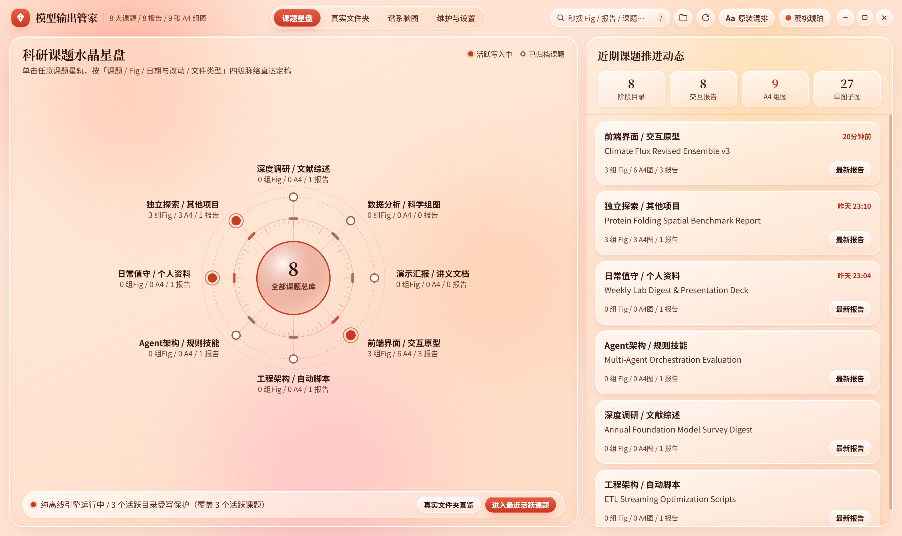
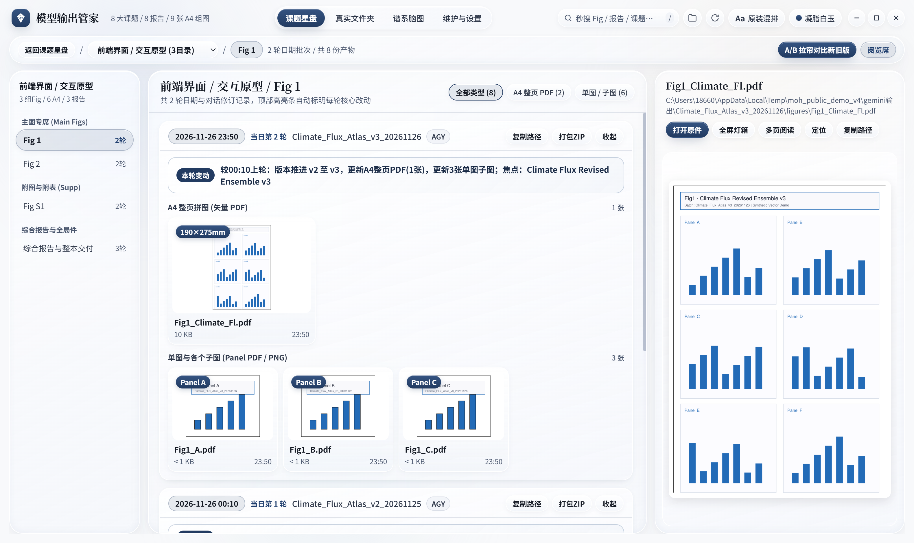
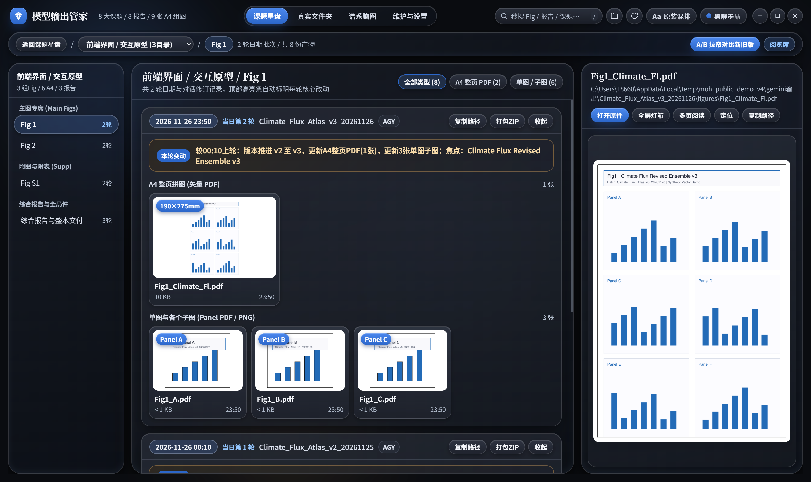

# 模型输出管家 · Model Output Hub (v4.0)

> **水晶课题星盘 × 四级脉络画册 × A/B 组图对比镜 × 零烧钱改动摘要 × 纯离线热更新**  
> 一款专为多 Agent 重度科研与开发创作者（Claude Code / Gemini Antigravity / Grok / Codex / Cursor / Windsurf 等）打造的 **Windows 11 原生无边框柔和水晶果冻桌面工作台**。100% 纯离线单文件（`1.1 MB`）、零外网强制依赖、零侵入原目录，并支持 GitHub Releases 一键静默热更新。



---

## v4.0 核心升级

1. **五套柔和水晶果冻色板 + 完整 9 款字体切换器**：
   - 默认主视觉为 **蜜桃琥珀果冻（Peach）**，新增 **凝脂白玉果冻（Alabaster · 偏白浅色）** 与 **黑曜墨晶果冻（Obsidian · 偏黑深色）**，并保留 **晨雾冰晶（Dewdrop）** 与 **星云紫晶（Amethyst）**。
   - 顶栏 `Aa` 保留 9 款中文字体与字重实时切换（原装杂志混排、霞鹜文楷加粗/特粗/常规、微软雅黑、标准楷体、华文楷体、思源宋体、现代等线）及两档字号。
2. **首屏水晶课题星盘 ↔ 四级脉络深潜架构**：
   - 首屏大画幅展示折射星轨课题星盘，点击任意课题钻入清晰的四级结构：**① 课题（Topic） → ② Fig 专席（自动解析文件名 + 父目录路径） → ③ 日期与对话批次（带显眼「本轮变动」一句话摘要条） → ④ 文件类型分栏（HTML 报告 / A4 整页 PDF / 单图与子图 / PPT·文稿·表格）**。
3. **双层零烧钱「本轮改了什么」摘要引擎**：
   - **默认纯本地零费用层**：自动对比同 Fig 前后两轮的 A4 尺寸/体积变化、子面板增减、报告版本推进与目录焦点词，毫秒级生成简短可读变动说明（不堆砌冗长原始提示词）。
   - **可选极轻量 AI 微摘要层**：可在「维护与设置」中按需接入任意 OpenAI 兼容轻量非推理模型（硬限 `≤120 tokens` 输入、零推理，结果永久落盘缓存 `batch_diff_cache.json`，绝不重复花钱）。
4. **实用科研级高频交互**：
   - **新旧组图 A/B 拉帘 / 并排对比镜**：同 Fig 跨轮次版本一键叠图拉帘对比或双图并排缩放（适应画幅 / 145% / 200%），逐像素核对排版与配色差异。
   - **`Space` 键全屏高清灯箱**（`←/→` 极速翻子图）、**一键复制本轮全套定稿绝对路径**、**一键导出本轮定稿 ZIP 归档包**、实时 Markdown 富文本阅览席与全盘磁盘穿透检索。
5. **纯离线免安装单文件 + GitHub 无缝热更新**：
   - 所有 `WebView2` 托管/原生 DLL 与 `PyMuPDF` 缩略图管道均内嵌至单个 `模型输出管家.exe`，断网 100% 满血运行；联网时后台静默检测 GitHub Releases 新版，下载并完成 PE 头完整性校验后通过 Windows 运行态 `.old` 重命名无缝热替换重启升级。

| 四级脉络工作台（蜜桃琥珀） | 凝脂白玉（偏白） / 黑曜墨晶（偏黑） | A/B 拉帘对比镜（星云紫晶） |
| :---: | :---: | :---: |
|  |  |  |



---

## 快速开始

### 方式一：下载免安装单文件（推荐）
1. 前往 **[Releases](../../releases)** 下载 **`ModelOutputHub-v4.0.0-SingleFile-win-x64.zip`**（或直接下载 **`ModelOutputHub-v4.0.0-win-x64.exe`**）。
2. 双击 **`模型输出管家.exe`**，点击顶栏目录图标选择你的大模型输出总文件夹即可使用。

### 方式二：源码一键编译（无需 Visual Studio）
```bash
git clone https://github.com/benweilu316/model-output-hub.git
cd model-output-hub
python build.py
```

## 开源协议
MIT License
