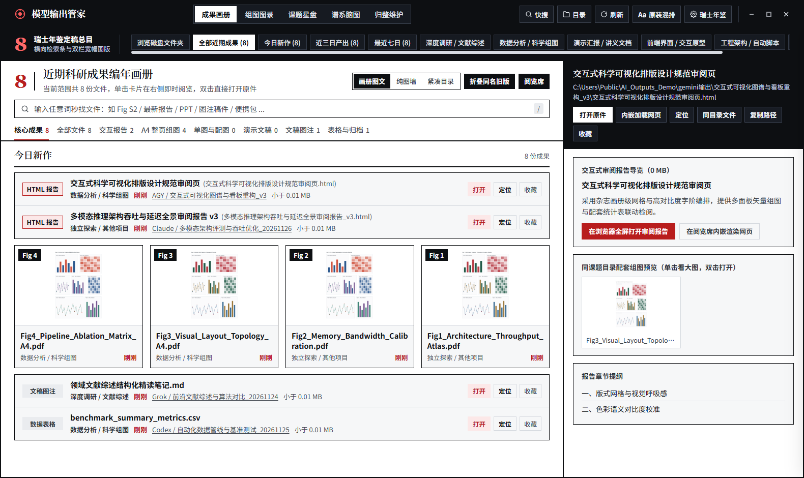
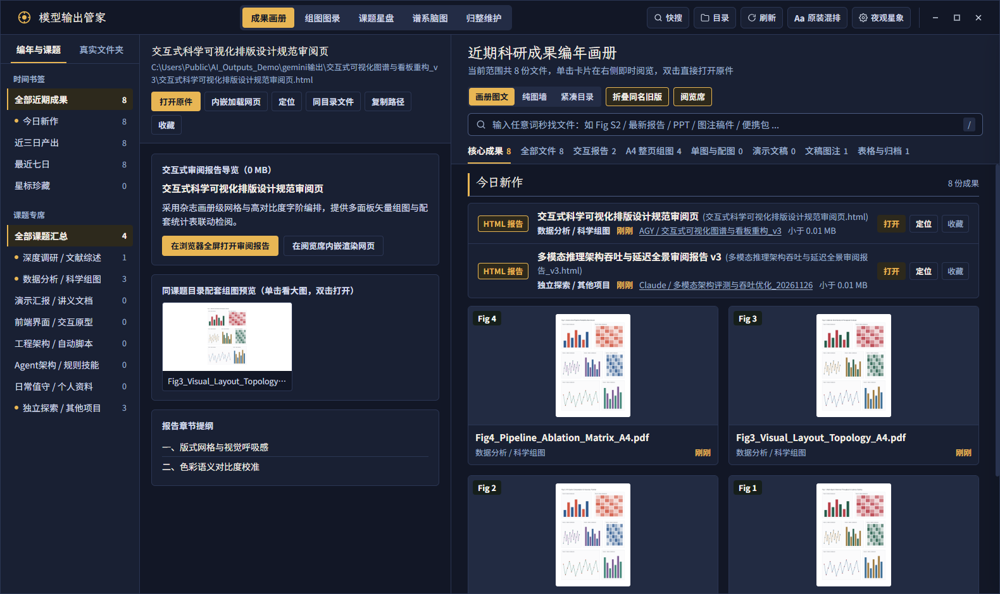
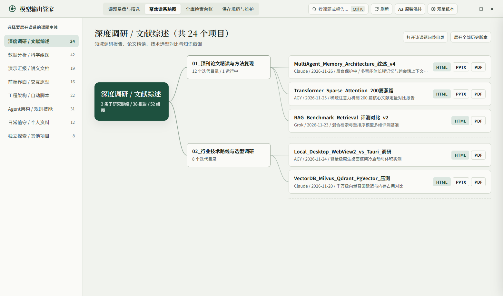

# 模型输出管家 · Model Output Hub (v3.0)

> **让日益增长的大模型产出像翻阅画册一样一目了然，找文件不费劲、不烧心。**  
> 一款专为多 Agent 重度创作者与科研工作者（Claude Code / Gemini Antigravity / Grok / Codex / Cursor / Windsurf 等）打造的 **Windows 11 原生无边框杂志画册级桌面文件管家**。100% 纯离线单文件（`1.1 MB`）、零外网依赖、零侵入原有目录，把成百上千个阶段文件夹自动提纯为清晰的**时间编年画册、真实组图画廊、课题定稿专席与即时阅览席**。


---

## v3.0 核心升级：杂志画册美学 × 一眼看清日益增长的文件

- **纯粹离线本地架构（零云端依赖、零配置负担）**：专注把「本地视觉展示与快速检索」做到极致——所有 `WebView2` 组件与高速扫描引擎均内嵌进单个 `1.1 MB` 的 `模型输出管家.exe`，无需联网、无需配置任何 API 密钥、无需安装 Python，免疫浏览器下载 `Zone.Identifier` 拦截，双击即用。
- **首屏三段式「时间编年画册流」**：
  - **置顶主交付件 + 真图画廊同屏直达**：按「今日新作 / 昨日产出 / 最近七日 / 历史月度」自动分章；每章首屏先呈现 1–2 份最新交互式 HTML 审阅报告，紧接直接铺开高分辨率真实 PDF 组图、PPTX 与配图画廊，配套图注文稿与数据表优雅收纳于下方，告别在传统后台密集列表里大海捞针。
  - **智能降噪「核心成果」**：自动隐藏切片过程图、`MANIFEST`、`_INDEX` 等工程辅助杂项，只把真正要看的定稿推到眼前（切到「全部文件」或输入关键词仍可全量穿透检索）。
- **毫秒级即时阅览席（零白板闪烁）**：
  - **大型单文件 HTML 报告导览卡**：面对 10–30 MB 的内嵌 Base64 大型网页报告，毫秒级流式提取标题、章节提纲与同课题配套组图 2×2 真图网格，支持一键浏览器全屏打开或按需内嵌渲染；
  - **PDF 纯净高清画板 + 多格式直看**：单击即看 `960px` 矢量组图高清画板（支持单击 100% 原寸放大与切换多页阅读器）、PNG/SVG 图像、Markdown/TXT 文稿、CSV/TSV 表格与 ZIP 包内清单。
- **三维立体找文件**：左侧随时切换「时间书签 + 课题定稿专席」与「真实磁盘文件夹浏览器」；顶栏支持空格多词联动与中英同义词毫秒级全盘穿透检索。

---

## 三套真正不同版式骨架的工作室视觉范式

摒弃“换皮不换骨”的廉价主题切换，也绝不使用花花绿绿的后台管理彩色贴纸。右上角一键切换三套拥有**独立版式骨架、分栏动线与纸墨色谱**的编辑部范式（自动记忆个人偏好）：

| 观星纸本（Takram Atlas · 默认） | 瑞士年鉴（Pentagram Broadsheet） | 夜观星象（Sugiura Star-Atlas） |
| :---: | :---: | :---: |
| 青瓷草木宣纸底 `#E6EEE8` · 经典左书签轨 + 中三列画册 + 右纸本阅览席 | 顶部通栏浓墨索引刊头 `#0D0F12` + 朱红刊号 · 无左栏双栏宽幅四列建筑网格 | 午夜星图靛墨底 `#121726` + 鎏金刻度 · 左目录轨 + 中央星图放大阅览镜 + 右双列大画幅图版 |





---

## 五大核心视图与贴心细节

1. **成果画册（默认首屏）**：时间编年流、单课题最新定稿专席（自动汇集最新 HTML 报告、PPTX 与 4 张代表性 A4 组图）、真实磁盘文件夹直览与即时阅览席。
2. **组图图录**：利用 PDF `/MediaBox` 物理毫米幅面自动分离「整页 A4 复合大组图」与「独立单面板切图」，支持按 `Fig 1 → Fig S8` 论文图序或时间排列。
3. **课题星盘**：同心刻度总览各主线课题体量与近期活跃写入锁状态。
4. **聚焦谱系脑图**：100% 原大字号（`15px / 16.5px`）横向三次贝塞尔演进树，告别缩小成蚂蚁字的全局导图，末端一键直开定稿。
5. **9 款中文字体切换 + `Ctrl + K` 全局快搜 + 常驻系统托盘**：
   - 顶栏 `Aa` 一键切换 **原装杂志混排、霞鹜文楷（加粗/特粗/常规）、微软雅黑、标准楷体、华文楷体、思源宋体、现代等线** 及两档字号舒适度；
   - 点击右上角 `×` 默认静默缩入右下角系统托盘常驻守护，单击托盘图标秒级唤起，内置单实例互斥唤醒与活跃会话防误伤锁。



---

## 快速开始（下载即用）

### 方式一：直接下载免安装便携包或单文件 `.exe`（推荐）
1. 前往 **[Releases](../../releases)** 下载最新的 **`ModelOutputHub-v3.0.0-SingleFile-win-x64.zip`**（或完整版 `ModelOutputHub-v3.0.0-win-x64.zip`）。
2. 解压后双击 **`模型输出管家.exe`**：
   - **随处运行**：点击顶栏 **「目录」** 按钮，选择你存放大模型输出的总文件夹，即刻生成编年画册、组图库与聚焦脑图；
   - **或放入目录运行**：直接把 `模型输出管家.exe` 放进你的输出总目录双击打开即可自动识别。

> **运行环境要求**：64 位 Windows 10 / 11（系统自带 `.NET Framework 4.8` 与 `Edge WebView2`，**开箱零第三方依赖**；可选增强：若本机装有 Python 3 + `pymupdf`，后台将自动启用零孤儿进程 `fitz` 矢量 PDF 超清缩略图渲染引擎）。

### 方式二：从源码一键编译（无需安装 Visual Studio）
直接调用 Windows 系统内置 `csc.exe`，3 秒完成单文件内嵌编译与自检：

```bash
git clone https://github.com/benweilu316/model-output-hub.git
cd model-output-hub
python build.py
```

构建产物位于 `dist/ModelOutputHub/`、`dist/ModelOutputHub-v3.0.0-win-x64.zip` 与 `dist/ModelOutputHub-v3.0.0-SingleFile-win-x64.zip`。

---

## 自定义课题分类规则（可选）

默认内置 8 大通用 AI 研发/科研/创作主题自动聚类。如需定制个人研究课题分类：

1. 将 `_hub_app/custom_topics.example.json` 复制为 `_hub_app/custom_topics.json`；
2. 修改其中的 `topics` 与 `rules` 文件夹匹配词；
3. 点击软件顶栏 **「刷新」** 即刻生效。

---

## 目录结构

```text
├── build.py                        # 零 VS 依赖一键单文件构建与打包脚本
├── src/
│   ├── ModelOutputHubApp.cs        # Win11 无边框宿主 + 内存程序集加载 + 缩略图/导览路由 + 托盘守护
│   ├── studio_ui.dat               # 内嵌三骨架杂志画册级前端源码（100% 离线零外部 CDN）
│   ├── thumb_worker.py             # 零孤儿匿名管道 PyMuPDF 矢量 PDF 高清缩略图渲染器
│   ├── topic_rules.py              # 全 9 类成品扫描、PDF 物理尺寸分流与活跃会话锁引擎
│   ├── tidy_outputs.py             # 无损散件归整与 Windows .lnk 快捷方式树生成（支持 --rollback）
│   ├── custom_topics.example.json  # 自定义课题分类规则示例
│   └── app.ico                     # 多尺寸应用程序图标
└── docs/
    └── screenshots/                # 脱敏演示环境实机界面预览截图
```

## 开源协议

本项目基于 [MIT License](LICENSE) 开源。
