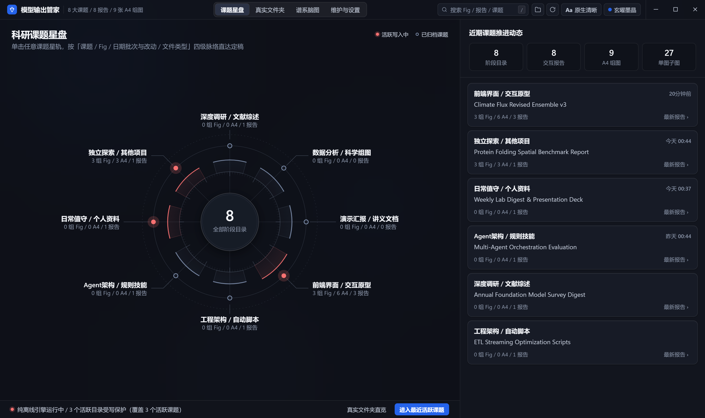
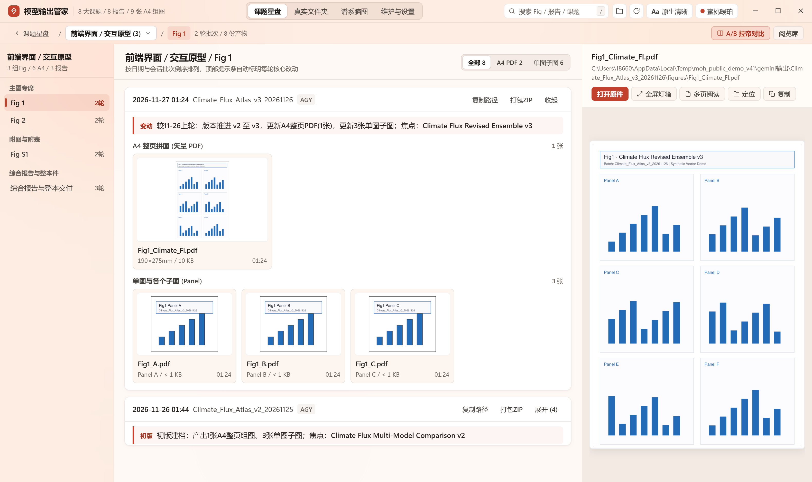
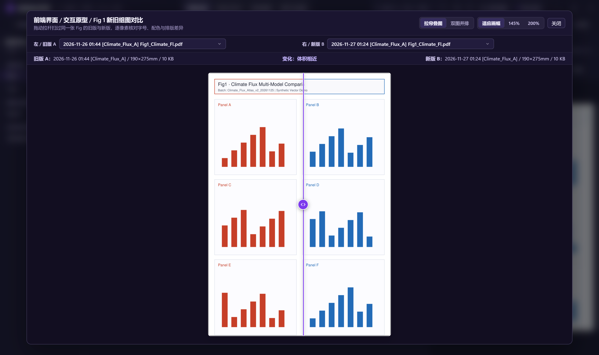

# 模型输出管家 · Model Output Hub (v4.1)

> **4K PerMonitorV2 锐显光学玻璃 × 精密科研星盘 × 四级脉络工作台 × 1920px A/B 组图对比镜 × 纯离线热更新**  
> 一款专为多 Agent 重度科研与开发创作者（Claude Code / Gemini Antigravity / Grok / Codex / Cursor / Windsurf 等）打造的 **Windows 11 原生旗舰级桌面工作台**。100% 纯离线单文件（`1.1 MB`）、零外网强制依赖、零侵入原目录，并支持 GitHub Releases 一键静默热更新。


---

## v4.1 旗舰清晰度与原生质感重塑

1. **真 4K 高分屏原生锐显（PerMonitorV2）**：
   - 内嵌官方 Windows 11 `PerMonitorV2` DPI 清单并配合 DWM 暗色模式与细边窗口同步，彻底杜绝高分屏缩放发糊；
   - 默认采用 Windows ClearType 原生锐利无衬线体系（`Segoe UI Variable` + `微软雅黑 UI`），A4 组图预览与对比镜跃升至 `1920px` 高清规格；
   - 顶栏采用原生 Windows 11 平铺窗控并替换全部浏览器原生 `<select>` 下拉框。
2. **五套柔和光学玻璃色板（高锐度纯实阅读面）+ 10 款字体切换**：
   - 默认主视觉 **蜜桃暖珀（Peach）**，提供 **凝脂月白（Alabaster）**、**玄曜墨晶（Obsidian · Linear 级深色）**、**晨雾清露（Dewdrop）** 与 **星云紫晶（Amethyst）** 五套柔和光学玻璃色板——微光通透侧栏搭配 96% 纯实高对比阅读工作面。
   - 顶栏 `Aa` 支持 10 款中文字体与字重实时切换（原生清晰、杂志混排、微软雅黑、霞鹜文楷三字重、等线、思源宋体、标准/华文楷体）及两档字号。
3. **精密天文星象仪首屏 ↔ 四级脉络深潜架构**：
   - 首屏大画幅展示极坐标精密星象仪，点击任意课题进入无缝分栏四级工作台：**① 课题 → ② Fig 专席 → ③ 日期与对话批次（Linear 风格左侧竖线「变动」提示条 + 智能首展 A4 缩略图）→ ④ 文件类型分栏（HTML 报告 / A4 PDF / 单图子图 / 文稿与表格）**。
4. **双层零烧钱变动摘要 + 高频科研工具**：
   - 默认纯本地 0 费用毫秒差分引擎，另支持可选 OpenAI 兼容轻量非推理微摘要（硬限 `≤120 tokens` 输入，永久本地缓存）。
   - 内置 1920px **A/B 拉帘叠图 / 双图并排对比镜**（适应画幅 / 145% / 200%）、`Space` 全屏高清灯箱、一键复制整轮定稿绝对路径、一键导出定稿 ZIP 包与 Markdown 富文本阅览席。
5. **纯离线免安装单文件 + GitHub 无缝热更新**：
   - 所有 `WebView2` DLL 与 `PyMuPDF` 缩略图管道均内嵌至单个 `模型输出管家.exe`，断网 100% 满血运行；联网时后台静默检测新版并支持 PE 校验后运行态 `.old` 零闪烁热替换重启升级。

| 玄曜墨晶星象仪（深色首屏） | 蜜桃暖珀四级工作台 | 1920px A/B 拉帘对比镜 |
| :---: | :---: | :---: |
|  |  |  |

| 凝脂月白（偏白浅色系） | 玄曜墨晶（Linear 级深色工作台） |
| :---: | :---: |
|  |  |

---

## 快速开始

### 方式一：下载免安装单文件（推荐）
1. 前往 **[Releases](../../releases)** 下载 **`ModelOutputHub-v4.1.0-SingleFile-win-x64.zip`**（或直接下载 **`ModelOutputHub-v4.1.0-win-x64.exe`**）。
2. 双击 **`模型输出管家.exe`**，点击顶栏目录图标选择你的大模型输出总文件夹即可使用。

### 方式二：源码一键编译（无需 Visual Studio）
```bash
git clone https://github.com/benweilu316/model-output-hub.git
cd model-output-hub
python build.py
```

## 开源协议
MIT License
