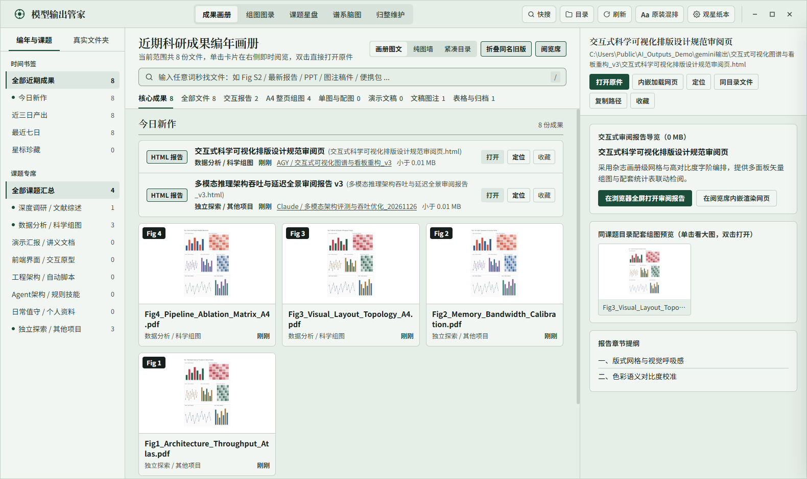

# 模型输出管家 · Model Output Hub

> **用来管理大模型的输出，文件一下找到，不烧心。**  
> 一款专为重度多 Agent 用户（Claude Code / Gemini Antigravity / Grok / Codex / Cursor / DeepSeek 等）打造的 **Win11 原生无边框圆角桌面客户端**。保持各 Agent 原有输出目录零改动、不打断任何正在运行的后台对话，用一张**同心刻度星盘**与 **100% 原大字号聚焦谱系脑图**，一秒直达最新交互式 HTML 报告、PPTX 演示文稿与出版级 PDF 拼图。



---

## 为什么做这个工具？

当你同时用多个 AI Agent 跑调研、写代码、出组图、改 PPT 时，本地输出目录很快会长出几百个带 `_v2`、`_v8`、`_revised`、`_20261126` 的阶段文件夹：

1. **不敢乱挪文件夹**：正在后台运行的 Agent 会话、跨会话交接单和自动化脚本往往绑定了原始路径，手动搬目录极易导致在跑任务报错断链。
2. **定稿埋在过程切片里**：一个课题目录下可能有几百张单面板切图、日志与快照备份，每次想打开最终那份 `.html` 报告或整页 `.pdf` 都要翻半天。
3. **传统全局思维导图缩成“蚂蚁字”**：几百个项目一次性展开在一棵大树上，缩放到 `0.3x` 根本没法看。

**模型输出管家** 采用 **「写读分离 · 零侵入索引」** 架构：各 Agent 继续往各自的 `<平台名>输出\` 目录安心写盘，桌面管家自动提纯黄金定稿、锁定保护活跃目录，并提供极速视觉检索台。

---

## 核心特性

### 1. 三套独立骨架与色谱的工作室视觉范式
告别千篇一律的企业后台卡片墙。右上角一键实时切换三套不同骨架结构与阅读气质的界面范式（自动持久化记忆偏好）：

| 观星纸本（Takram Atlas · 默认） | 瑞士年鉴（Pentagram Grid） | 夜观星象（Sugiura Dark） |
| :---: | :---: | :---: |
| 植物灰宣纸底 + 松针墨绿同心刻度星盘 | 浓墨海报横幅刊头 + 纯白建筑黑线密度条 | 黑曜墨底 + 鎏金朱砂天文星轨（夜间护眼） |


### 2. 100% 原大字号「聚焦谱系脑图」
左侧点选主线课题，画布按 **「课题母节点 → 二级研究脉络 → 最新定稿节点」** 横向绘制三次贝塞尔连线树。全程锁定 `15px / 16.5px` 清晰字号，末端直接点击 `HTML` / `PPTX` / `PDF` 胶囊一键打开文件，早期历史版本默认折叠、按需展开。


### 3. 9 款中文字体切换 + `Ctrl + K` 全局指令台 + 常驻系统托盘
- **多字体实时切换（顶栏 `Aa` 按钮）**：内置 **霞鹜文楷（加粗 / 特粗 / 常规）**、**微软雅黑**、**标准楷体**、**华文楷体**、**思源宋体**、**现代等线** 与 **原装杂志混排**，支持 `15px / 16.5px` 两档字号舒适度调节。
- **`Ctrl + K` 悬浮秒搜**：随时呼出指令面板，输入任意课题名、关键词或版本号（如 `v6`、`综述`、`组图`），上下键选定回车直接打开对应文件。
- **默认关闭最小化到系统托盘**：点击右上角 `×` 自动静默缩入右下角系统托盘常驻守护（单击托盘图标秒级唤起，右键托盘图标提供快捷搜索与彻底退出；内置单实例互斥唤醒，重复双击图标自动激活已有窗口）。
- **活跃会话防误伤锁 + Windows `.lnk` 快捷方式树**：自动识别近期活跃写入与运行中的 Agent 会话加锁保护；支持一键生成 `00_按课题总览\` 原生快捷方式目录（含 `--rollback` 无损回滚台账）。

---

## 快速开始（开箱即用）

### 方式一：直接下载绿色免安装包（推荐）
1. 前往右侧 **[Releases](../../releases)** 下载最新 `ModelOutputHub-v1.0.0-win-x64.zip`。
2. 将压缩包内的 `模型输出管家.exe` 和 `_hub_app` 文件夹解压到你的 **大模型输出根目录**（例如 `D:\AI_Outputs\` 或 `Desktop\模型输出\`，该目录下可存放 `claude输出\`、`gemini输出\`、`codex输出\` 等子目录，也可直接存放普通项目文件夹）。
3. 双击 **`模型输出管家.exe`** 即可秒开使用！

> **运行环境要求**：Windows 10 / 11 (x64)（系统自带 WebView2 Runtime 与 .NET Framework 4.8）；首次扫描与增量整理需本机装有 Python 3.8+（如需生成 `.lnk` 快捷方式树可安装 `pip install pywin32`）。

### 方式二：从源码一键编译（无需安装 Visual Studio！）
本项目直接调用 Windows 系统内置的 `.NET Framework x64 csc.exe` 编译，**零 Visual Studio 依赖**，3 秒即可打包出独立 `.exe`（UI 资源直接编译内嵌进二进制）：

```bash
git clone https://github.com/benweilu316/model-output-hub.git
cd model-output-hub
python build.py
```

构建完成后，便携版程序与压缩包位于 `dist/ModelOutputHub/` 与 `dist/ModelOutputHub-v1.0.0-win-x64.zip`。

---

## 自定义你的专属课题分类（可选）

开箱默认提供 8 大通用 AI 研发/创作主题自动聚类。如果你想按自己的研究课题或业务线定制星盘主线：

1. 将 `_hub_app/custom_topics.example.json` 复制重命名为 `_hub_app/custom_topics.json`。
2. 按需修改其中的 `topics`（星盘节点名称）与 `rules`（文件夹关键词匹配规则）。
3. 点击软件右上角 **「刷新」** 即可立即生效。

---

## 目录结构

```text
├── build.py                        # 零 VS 依赖一键构建与打包脚本
├── src/
│   ├── ModelOutputHubApp.cs        # Win11 无边框圆角宿主 + 系统托盘常驻 + 单实例唤醒 + WebView2 内存路由
│   ├── studio_ui.dat               # 内嵌三范式工作室级前端源码（零外部 CDN 依赖）
│   ├── topic_rules.py              # 多平台目录扫描、黄金定稿提纯与实时活跃锁引擎
│   ├── tidy_outputs.py             # 无损散件归整与 Windows .lnk 快捷方式树构建器（支持 --rollback）
│   ├── custom_topics.example.json  # 自定义课题分类规则示例
│   └── app.ico                     # 多尺寸应用程序图标
└── docs/
    └── screenshots/                # 实机界面预览截图
```

## 开源协议

本项目基于 [MIT License](LICENSE) 开源。
